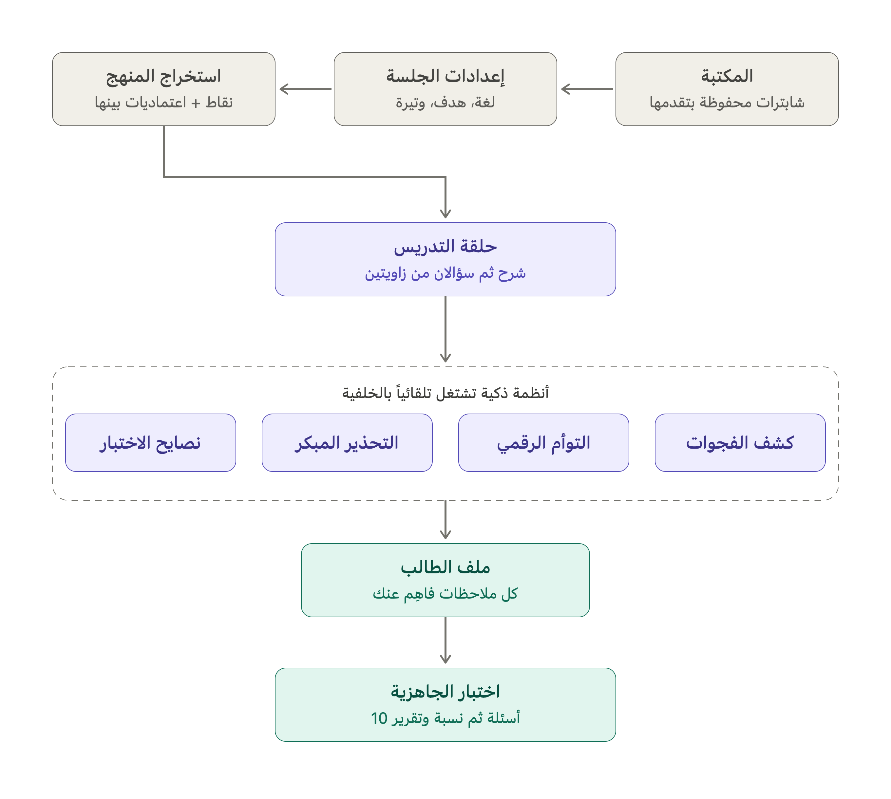

# Fahem (فاهِم) — Arabic AI Tutoring Agent

Fahem is an LLM-powered tutor for Arabic-speaking students. Upload a chapter as a PDF and Fahem teaches it in colloquial Arabic: it checks understanding instead of only explaining, spots knowledge gaps, adapts to the student's learning style, and ends with a readiness test.



## Highlights

- **Live coverage map.** Every point in the chapter is extracted with its prerequisites and coloured as mastered, weak or current.
- **Understanding, not memorisation.** A point counts as mastered only after two correct answers from two different angles.
- **Gap detection.** Two wrong answers in a row trigger a root-cause diagnosis, a short remedial path, then a return to the chapter.
- **Learning-style adaptation.** The agent notices whether the student prefers examples, visuals or short explanations and adjusts.
- **Early warning.** A weak point that later points depend on raises a warning before the student gets stuck.
- **Readiness test.** Ten graded questions (including tricky ones) produce a readiness report with a percentage.
- **Persistent sessions.** Each chapter's conversation and progress are saved, so a student can come back later.

The behaviour was tuned through repeated rounds of prompting and evaluation with real chapters.

## Run it

```bash
python3 -m venv venv && source venv/bin/activate
pip install -r requirements.txt
export ANTHROPIC_API_KEY=your-key
uvicorn main:app --host 0.0.0.0 --port 8000
```

Then open http://localhost:8000. The API key stays on the server and never reaches the browser.

**Tech:** Python · FastAPI · Anthropic Claude API · HTML/JS frontend (RTL Arabic)

**Author:** Ritaj Albogami — built during the Tuwaiq Academy AI & Data Science Diploma, 2026.

---

## بالعربي

Agent تعليمي لا يكتفي بالشرح: يتأكد من الفهم، يكشف الفجوات المعرفية،
يتكيف مع أسلوب الطالب، ويختبر جاهزيته في النهاية.

## المزايا الذكية

| الميزة | كيف تعمل |
|---|---|
| **خريطة التغطية الحيّة** | استخراج كل نقاط المنهج مع اعتمادياتها، وتلوينها: ✓ مُتقنة، ! ضعيفة، 🟡 الحالية |
| **كشف الحفظ بدون فهم** | لا تُعتبر النقطة مُتقنة إلا بإجابتين صحيحتين من زاويتين مختلفتين |
| **كشف الفجوات المعرفية** | خطآن متتاليان → تشخيص السبب الجذري (حتى خارج المنهج) → مسار علاجي قصير → العودة للمنهج |
| **التوأم الرقمي** | يرصد أسلوب تعلم الطالب (أمثلة؟ رسومات؟ شرح مختصر؟) ويكيّف شروحه تلقائياً |
| **التحذير المبكر** | نقطة ضعيفة + نقاط قادمة تعتمد عليها → تحذير قبل التعثر |
| **وضع الاختبار** | زر "اختبر جاهزيتي": 10 أسئلة متدرجة (منها خادعة) → تقرير جاهزية بنسبة مئوية |

## التشغيل

```bash
python3 -m venv venv && source venv/bin/activate
pip install -r requirements.txt
export ANTHROPIC_API_KEY=sk-ant-...
uvicorn main:app --host 0.0.0.0 --port 8000
```

ثم: http://localhost:8000

## الإعدادات

| المتغير | الافتراضي | الوصف |
|---|---|---|
| `FAHEM_MODEL` | claude-sonnet-4-6 | الموديل (claude-haiku-4-5 أرخص) |
| `FAHEM_MAX_MESSAGES` | 120 | حد الرسائل لكل جلسة |
| `FAHEM_MAX_TOKENS` | 3000 | أقصى طول للرد |

## البنية التقنية للمزايا

- الاستخراج يرجع لكل نقطة حقل `needs` (المتطلبات السابقة) — أساس التحذير المبكر وكشف الفجوات.
- الوكيل يُنهي كل رد بوسم مخفي `<progress>` فيه: النقاط المُتقنة، الحالية، الضعيفة،
  الفجوة المكتشفة (alert)، وملاحظة أسلوب التعلم (style). الواجهة تفصل الوسم وتحدّث الخريطة.
- وضع الاختبار يبدّل system prompt كاملاً (معلّم → ممتحن) مع الحفاظ على سياق المحادثة،
  والتقرير النهائي يصل بوسم `<report>` يُعرض كبطاقة جاهزية.

## ملاحظات النشر

- المفتاح في السيرفر فقط (Secrets في Railway/Render) — لا يصل للمتصفح أبداً.
- الجلسات في الذاكرة؛ للإنتاج الجاد استبدلها بـ Redis.
- المنتج باسمك الخاص مع "Powered by Claude" — لا يُقدَّم كمنتج من Anthropic.

## الحفظ الدائم (v5)

- كل شابتر يُحفظ على القرص في مجلد `data/` تلقائياً: المحادثة، التقدم، النصايح، وملف الطالب كاملاً.
- الطالب يرجع بأي وقت (حتى بعد إعادة تشغيل السيرفر) ويلقى مكتبة شابتراته بنسبة إنجاز كل واحد، يكمّل أو يضيف شابتر جديد.
- هوية الطالب تُحفظ في متصفحه (localStorage) — تنبيه: مسح بيانات المتصفح أو التبديل لجهاز آخر يعني مكتبة جديدة فارغة (الحل الجذري لاحقاً: تسجيل دخول).
- عند النشر على Render: القرص في الخطة المجانية يُمسح مع كل إعادة نشر — للحفظ الجاد فعّلي Persistent Disk (مدفوع) أو انقلي التخزين لقاعدة بيانات.
- مجلد `data/` مستثنى من git في `.gitignore` — لا ترفعي بيانات الطلاب للمستودع أبداً.
